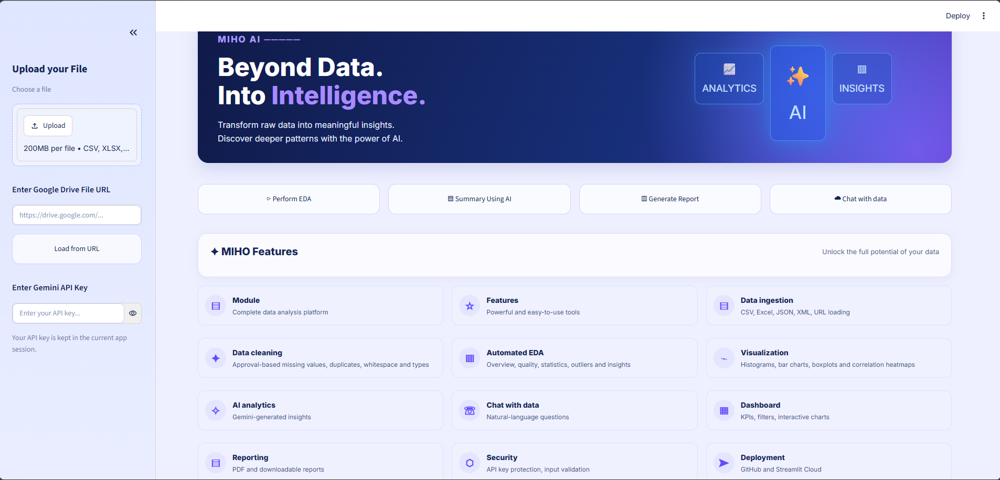
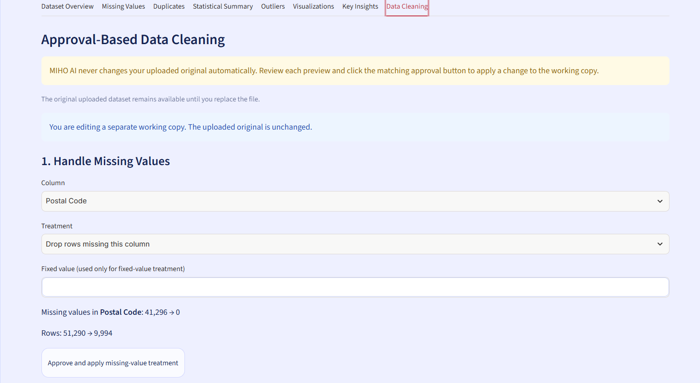
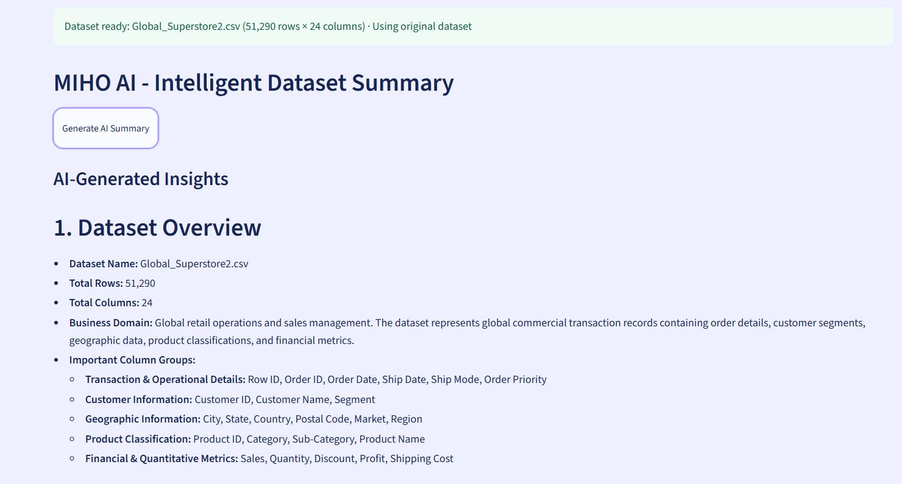
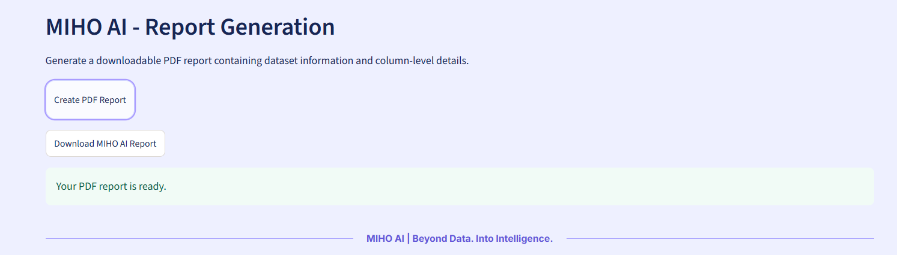

# MIHO AI – Beyond Data. Into Intelligence.

**MIHO AI** is an AI-powered data analysis platform built with Python and Streamlit. It helps users explore datasets, identify data quality issues, discover meaningful patterns, perform data cleaning, and generate intelligent business insights through an interactive interface.

## Overview

Data analysis often involves multiple tools and repetitive processes. MIHO AI brings essential data analysis capabilities together in one platform, making exploratory data analysis more accessible, efficient, and understandable.

## Features

### 1. Dataset Exploration
- Upload CSV, Excel, JSON, and XML files.
- Load datasets using supported URLs.
- View dataset dimensions, column information, and data types.
- Explore statistical summaries.

### 2. Automated Exploratory Data Analysis
- Dataset overview and profiling.
- Missing value analysis.
- Duplicate detection.
- Statistical analysis.
- Outlier detection using the IQR method.
- Interactive data visualizations.
- Automated key insights.

### 3. Data Cleaning
- Handle missing values.
- Remove duplicate records.
- Standardize column names.
- Trim unnecessary whitespace.
- Correct data types.
- Review outliers.
- Preview proposed changes before approval.

**Original datasets are not automatically modified. Users can review and approve cleaning operations.**

### 4. AI-Powered Analysis
- Generate AI-powered dataset summaries.
- Ask questions about datasets using natural language.
- Receive data-driven answers and business insights.

### 5. Automated Reporting
- Generate downloadable PDF analysis reports.
- Include dataset statistics, data quality findings, visualizations, and business insights.

## Technology Stack

| Technology | Purpose |
|---|---|
| Python | Core programming language |
| Streamlit | Interactive web application |
| Pandas | Data manipulation and analysis |
| NumPy | Numerical computations |
| Plotly | Interactive visualizations |
| Matplotlib | Report visualizations |
| Google Gemini API | AI-powered analysis |
| ReportLab | PDF report generation |

## Application Screenshots

The following screenshots showcase selected features and key interfaces of MIHO AI.

These images represent only a portion of the application. MIHO AI includes additional analysis views, data quality reports, interactive visualizations, data cleaning options, AI-powered insights, and reporting capabilities that are not all displayed here.

The screenshots provide a glimpse into the platform's functionality and user experience.
### 1. MIHO AI Homepage



### 2. Exploratory Data Analysis



### 3. Chat with Data 


### 4. AI-Powered Summary



### 5. Automated PDF Report



## Project Structure

```text
miho-ai/
│
├── app.py
├── requirements.txt
├── .gitignore
│
├── modules/
│   ├── __init__.py
│   └── profiler.py
│
└── .streamlit/
    └── config.toml
```

## Installation and Setup

### Prerequisites
- Python 3.10 or later
- Git
- A Google Gemini API key for AI-powered features

### 1. Clone the repository

```bash
git clone https://github.com/Madhumitha-Y-16/miho-ai.git
```

### 2. Navigate to the project directory

```bash
cd miho-ai
```

### 3. Create a virtual environment

```bash
python -m venv .venv
```

### 4. Activate the virtual environment

**Windows PowerShell:**

```powershell
.\.venv\Scripts\Activate.ps1
```

### 5. Install dependencies

```bash
pip install -r requirements.txt
```

### 6. Run the application

```bash
python -m streamlit run app.py
```

The application will open in your browser at:

`http://localhost:8501`

## AI Configuration

MIHO AI uses the Google Gemini API for AI-powered summaries and natural-language data analysis.

1. Obtain an API key from [Google AI Studio](https://aistudio.google.com/).
2. Launch MIHO AI.
3. Enter your API key in the application sidebar.
4. Use the AI-powered features.

**Security:** Never commit API keys, passwords, or private credentials to the repository.

## Project Goals

MIHO AI aims to simplify data analysis by combining automated EDA, data quality assessment, approval-based data cleaning, AI-assisted interpretation, and reporting in one accessible platform.

## Future Scope

Potential future enhancements include:
- Predictive analytics.
- Machine learning integration.
- Advanced business intelligence.
- Additional data connectors.

## Author

**Madhumitha Y**

GitHub: [Madhumitha-Y-16](https://github.com/Madhumitha-Y-16)

---

*MIHO AI - Beyond Data. Into Intelligence.*
